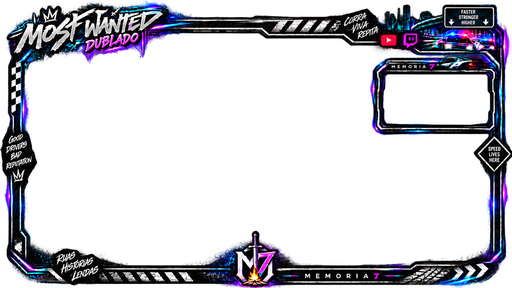

<h1 align="center">🎮 Memoria7 — Ferramentas para Streaming</h1>

<strong>Projeto pessoal de desenvolvimento Front-End aplicado a transmissões ao vivo</strong>

## 📺 Sobre o projeto

O **Memoria7 (M7)** é meu projeto pessoal de conteúdo sobre games, nostalgia e experiências compartilhadas em família. Neste repositório, reúno interfaces e recursos técnicos desenvolvidos para as transmissões, colocando em prática conceitos de **HTML, CSS, JavaScript, animações e integração visual com o OBS Studio**.

Este portfólio documenta tanto a criação de componentes visuais quanto os desafios de configurar e testar elementos em cenas reais de streaming.

## 🚀 Projetos e recursos

### ⚔️ Dark Souls II — overlay interativo

- [Overlay original em HTML](overlays/dark-souls-2/memoria7_overlay.html)
- [Overlay V2 com painel e efeitos](overlays/dark-souls-2/Memoria7_DarkSouls2_Overlay_V2.html)
- [Guia de configuração e testes no OBS](docs/GUIA_MEMORIA7_OVERLAY_V2.txt)

**Recursos explorados:** composição de uma tela 1920 × 1080, moldura para webcam, painéis visuais, animações em CSS, ajustes de posicionamento e simulações de alertas em JavaScript.

**Atalhos do overlay V2** (na janela **Interagir** da fonte Navegador):

| Tecla | Função |
| --- | --- |
| T | Mostrar/ocultar painel de configuração |
| F1 | Simular novo seguidor |
| F2 | Simular inscrição |
| F3 | Simular doação |
| F4 | Simular batalha contra chefe |
| F5 | Simular derrota |

> ⚠️ Os alertas de seguidor, inscrição e doação funcionam em **modo de demonstração**. Este código não comprova integração automática com eventos reais da Twitch, do YouTube ou do StreamElements.

> ℹ️ Para manter o repositório leve, o arquivo V2 publicado usa a marca textual **M7** no lugar da imagem do logotipo incorporada ao arquivo de trabalho original. O restante do código foi mantido.

### 🏎️ Need for Speed: Most Wanted
Projeto de lives e vídeos do canal. Já temos uma **tela de pausa** na galeria visual. **O código do overlay interativo específico ainda está pendente de recuperação.**

### 🗡️ Hollow Knight
Conteúdo de transmissões e vídeos curtos, agora com **arte visual disponível na galeria**. **Arquivos técnicos de overlay pendentes de recuperação.**

### 👨‍👦 Lives em família — Cuphead, Mario e outros jogos
Experiências de transmissões com meu filho, envolvendo identidade visual e organização de cenas. **Arquivos de overlays e alertas específicos ainda não publicados neste repositório.**

## 🖼️ Galeria visual — materiais já publicados

Esta seção reúne algumas artes, miniaturas e telas utilizadas ou preparadas para o canal. **As imagens demonstram o trabalho de identidade visual e produção; não substituem os arquivos HTML dos overlays interativos.**

### 💜 Identidade do Memoria7

### 🎥 Cenas de transmissão

**Tela de início de live**

**Tela de pausa para Need for Speed: Most Wanted**

**Arte de overlay**

### 🖌️ Novas artes e variações de overlays

Também foram adicionadas **oito artes criadas ao longo de 2026**, que registram estudos visuais e variações de identidade para as transmissões. Mantive os nomes originais dos arquivos para não atribuir um jogo específico a uma imagem sem confirmação.

> Estas são **artes estáticas**. Os arquivos HTML/CSS/JavaScript dos overlays poderão ser adicionados separadamente quando recuperados.

### 🎮 Miniaturas e artes de conteúdo

| Dark Souls II | Hollow Knight |
| --- | --- |
|  |  |

| Kingdom Hearts | Outra miniatura do canal |
| --- | --- |
|  |  |

### 🎞️ Vídeo de encerramento

[▶️ Conferir vídeo de encerramento do Memoria7](imagens/memoria7_short_encerramento_sem_marca.mp4)

Outros arquivos visuais podem ser consultados na [pasta de imagens](imagens/). Os originais continuam disponíveis, sem renomeação ou exclusão.

---

## 🛠️ Como usar o overlay com OBS Studio

1. Configure uma cena do OBS em **1920 × 1080**.
2. Adicione o jogo à cena e ajuste-o à tela.
3. Adicione uma **Fonte Navegador** e marque a opção **Arquivo local**.
4. Selecione o arquivo HTML do overlay e defina largura **1920** e altura **1080**.
5. Posicione a webcam atrás da moldura do overlay, conforme as fontes da cena.
6. Para testar as interações, use **Interagir** na fonte Navegador e os atalhos da tabela acima.

O guia detalhado está em [docs/GUIA_MEMORIA7_OVERLAY_V2.txt](docs/GUIA_MEMORIA7_OVERLAY_V2.txt).

## 🧠 Conhecimentos aplicados

`HTML semântico` · `CSS` · `Animações` · `JavaScript` · `Interfaces personalizadas` · `Testes de interação` · `OBS Studio` · `Organização de projetos`

Na produção do canal também utilizo **Filmora** para edição de vídeos. Essa atividade é complementar ao desenvolvimento dos overlays.

## 🤖 IA como aceleradora do processo criativo

No Memoria7, utilizamos ferramentas de **inteligência artificial como apoio e aceleradoras** do processo de criação, sem substituir a revisão, os testes e as decisões criativas realizadas no projeto.

- **ChatGPT:** apoio na estruturação de ideias, escrita, desenvolvimento e ajustes de HTML, CSS e JavaScript, além de documentação e resolução de problemas.
- **Claude:** apoio complementar à produtividade, à exploração de soluções e ao trabalho com tecnologia.
- **Dreamina:** apoio à criação e à experimentação de elementos visuais para o canal.

Os resultados são selecionados, adaptados e testados conforme as necessidades reais das transmissões.

## 🎛️ Ferramentas de transmissão e edição

| Ferramenta | Papel no fluxo de produção |
| --- | --- |
| **OBS Studio** | Organização de cenas, captura de vídeo e áudio e utilização de overlays como fontes de navegador |
| **StreamElements** | Recursos de streaming, elementos e alertas para transmissões |
| **Restream** | Apoio ao fluxo de transmissão para diferentes plataformas |
| **Ghost Chat** | Acompanhamento de mensagens e interação durante as lives |
| **Filmora** | Edição, montagem e finalização de vídeos e cortes |

Essas ferramentas fazem parte do fluxo de produção do canal; seu uso não significa que todas tenham integração programática direta com os overlays deste repositório.

## ▶️ Canal oficial

Conheça o **Memoria7** no YouTube, onde os projetos visuais e as experiências de streaming ganham vida:

🎮 **[Acessar o canal Memoria7 no YouTube](https://www.youtube.com/channel/UCpyj0VLDMkHZHf2uR8GVXgA)**

---

## 🔐 Segurança e uso responsável

Este repositório não deve armazenar senhas, tokens de serviços de streaming, dados pessoais de seguidores ou credenciais de integração. Imagens, músicas e outros elementos de jogos de terceiros exigem atenção às licenças e direitos autorais.

## 🧭 Próximas melhorias

- Incorporar arquivos e configurações de novas lives (como Mario) após os testes no OBS e a revisão de conteúdos sensíveis;
- Documentar e incorporar overlays antigos conforme os arquivos forem recuperados;
- Separar melhor estilos e scripts em arquivos reutilizáveis;
- Complementar a galeria com capturas reais das cenas no OBS;
- Testar integração real com eventos de alertas, sem expor credenciais;
- Explorar um projeto de análise de métricas do canal usando SQL, Python ou Power BI.

---

<em>O tempo muda a gente, mas memórias boas nunca dão reset.</em> 💜

